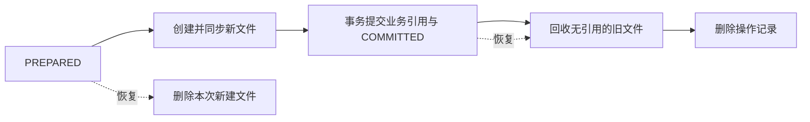

# 架构与设计

MolWorld 将浏览、上传、审核和管理放在一个 Next.js 应用中。页面在服务端查询数据并生成 HTML；浏览器组件处理剪贴板、下载和管理表单，通过 API 提交操作。SQLite 保存图片信息、标签、会话和统计，本地 `data/` 保存媒体文件。

部署单位是一台 Linux 主机。多个应用进程共享同一份数据库、媒体目录和配置，使用本机内核文件锁协调写入。这一结构把运行状态保存在同一主机上，备份、恢复和维护围绕数据库与媒体目录共同进行。锁和文件操作依赖本机文件系统语义，部署时所有进程使用同一项目目录。

## 一张图片如何进入公开图库

上传请求先按实际收到的字节限制大小，再解码图片，核对声明格式与图片内容。支持 PNG、JPEG、GIF 和 WebP，解码像素上限为 40,000,000。服务端检查同名记录和审核队列容量，在媒体操作日志下保存新文件；随后在同一事务中核对上传间隔、消耗冷却额度并建立 `PENDING` 记录。事务失败会清理新文件，成功上传才消耗冷却额度。此时原图和预览地址都指向 `data/uploads/` 中的同一文件，管理员可以预览。

审核页的“保存”更新名称和标签，记录继续待审。“通过”会将原图复制到图库中的新路径，并生成缩略图：静态图转为最长边 360 像素以内的 JPEG；动图转为同等尺寸上限的 GIF。缩略图生成后，数据库切换到新的原图、缩略图地址，并将状态改为 `PUBLISHED`。原来的上传文件随后进入回收目录。

已发布图片可以改为 `HIDDEN`。隐藏只修改公开状态，原图、缩略图、标签和热度均保留，恢复发布时沿用这些数据。删除会移除图片记录及标签关联；无其他记录引用的媒体进入 `data/trash/`。回收目录保存的是文件，图片标题、标签和状态的恢复来自数据库备份。

## 将文件变更与数据库提交连接起来

SQLite 事务覆盖数据库记录，文件的创建和移动由文件系统完成。MolWorld 用一条持久操作记录衔接这两部分，让恢复程序能够判断业务是否已经提交。

每次变更按以下顺序执行：

1. 在数据库写入 `PREPARED` 操作记录，列出准备创建的文件，以及提交后准备回收的旧文件。
2. 创建具有唯一名称的新文件，并同步文件内容和所在目录。原有文件此时仍在原位，现有数据库引用继续有效。
3. 在同一个 SQLite 事务中更新业务记录，并把操作标记改为 `COMMITTED`。数据库引用与提交标记同时生效。
4. 查询旧文件是否仍被任一图片的原图或缩略图字段引用。仍有引用的文件继续保留，其余文件移动到唯一的回收路径。
5. 同步相关目录，删除已经完成的操作记录。

发布、删除、文件重命名和缩略图维护都采用这套流程。共享文件的存活由全部记录的引用决定，因此删除一条记录后，其他图片仍能读取共同使用的媒体。新文件采用独立路径，避免生成缩略图或复制原图时覆盖正在被读取的旧内容。

进程启动时，以及下一次媒体写入开始前，应用会读取未完成的操作记录。`PREPARED` 表示业务事务尚未提交，恢复程序删除本次新建文件；`COMMITTED` 表示新引用已经生效，恢复程序继续回收旧文件。清理过程中再次退出时，记录留在数据库，下一次恢复继续处理。提交后的文件清理失败会保留数据库中的操作记录，并将错误写入进程日志，已提交业务仍以数据库中的新状态为准。

这套机制处理的是操作中断后的完成或回滚。恢复所用的原始数据仍是磁盘上的数据库和媒体；磁盘内容丢失时，使用二者同一时点的备份恢复。核心实现集中在 `src/lib/mediaFiles.ts`。

## 多进程怎样协调写入

媒体变更先取得 `data/.media.lock`，数据库读改写事务再取得数据库文件旁的 `.write.lock`。两种资源同时使用时顺序固定为“媒体锁 → 数据库锁”。媒体锁覆盖文件准备、数据库提交和旧文件清理，使发布、删除、孤儿文件清理及维护脚本按顺序操作同一媒体目录。

数据库锁协调应用进程之间的写入。SQLite 负责事务原子性，文件锁让涉及“读取当前值，再写入结果”的业务先排队，避免多个延迟事务同时升级写锁。单纯读取数据库的请求继续独立执行；复制计数、限流、会话变更等短事务仅占用数据库锁。

锁由 Linux `flock` 设置在打开的文件描述符上。Node 在操作期间保留该描述符，正常结束时关闭，进程退出时由内核释放。锁文件可以长期存在，持锁状态由内核维护。所有应用进程及维护命令使用相同的锁路径，因此进程重启后仍遵守相同的协调规则。

## 权限和缓存如何配合

媒体位于 `data/`，通过应用路由读取。启动检查会检测 `public/memes/`、`public/uploads/` 和 `public/trash/` 中的旧媒体；发现文件时要求先完成存储迁移。这样图片请求会经过数据库状态和会话检查。

每次媒体请求先核对路径，再查询公开引用：图库中的文件只要被一条 `PUBLISHED` 记录引用，就可以公开读取；上传文件和其余图库文件需要有效管理员会话，匿名请求得到 404。共享媒体的权限也遵循这个引用规则，例如一个文件同时属于已发布和隐藏记录时，已发布引用使该文件保持公开。

公开媒体响应使用 `max-age=0, must-revalidate`。浏览器可保存内容，但再次使用时向服务器核验权限和版本；权限通过且 ETag 或修改时间匹配时返回 304。私有媒体使用 `private, no-store`。图片隐藏后，后续匿名请求会按新的状态处理。

列表和搜索 API 的共享缓存时长可在后台设置，缓存期内的 JSON 可以继续包含先前的名称、标签或图片地址，媒体请求仍单独核验权限。首页直接查询数据库并动态渲染，管理接口和交互凭据使用 `no-store`。Next Image 的再次优化已全局关闭，浏览器直接向媒体路由发送管理员 Cookie。

数据库保存字面文件名，输出浏览器 URL 时逐段编码。中文、空格以及 `#`、`?`、`%` 都作为文件名内容处理，避免它们被解释成片段、查询参数或转义序列。

## 管理员会话与操作时机

管理员密码使用 scrypt 派生值校验。首次配置来自环境变量；后台修改密码后，数据库中的凭据成为后续认证依据。数据库凭据每次检查时重新读取，因此各进程能观察到同一份最新状态。

登录成功后，浏览器收到随机会话令牌，Cookie 使用 HttpOnly、SameSite=Lax，生产环境附加 Secure。数据库保存令牌摘要、账号、过期时间以及签发时的密码摘要版本。每次认证同时检查会话是否存在、是否过期、凭据版本是否仍一致。

耗时操作的起点与实际写入之间存在时间差。登录流程完成密码校验后，在创建会话的事务中再次核对凭据；改密流程在读取请求和完成密码派生后，在提交事务内再次验证当前会话。改密、撤销全部旧会话和签发当前浏览器的新会话在一个事务里完成。等待媒体锁的管理请求取得锁后也重新认证，使排队期间已撤销的会话在实际操作前失效。

来源检查核对修改请求的 `Origin` 主机。登录、上传和匿名 API 的限流窗口保存在 SQLite 中，各进程共享计数，重启后沿用尚未结束的窗口。后台参数同样每次从数据库读取，浏览器已打开页面中的参数则在下次加载时更新。

## 排序与抽样的成本放在哪里

公开列表始终以 `PUBLISHED` 为查询条件。最新、最早排序使用创建时间和 ID，确保时间相同的记录也有确定顺序。热度等于复制次数加下载次数；SQLite 触发器在计数变化时同步热度列，查询通过热度索引获取当前页。

名称排序使用中文比较规则，并按数值比较名称中的数字，例如 `mol2` 排在 `mol10` 前。SQLite 保存一个表示该顺序的 `nameOrder` 数值，让页面读取可以直接按索引分页。迁移和导入时统一生成顺序；新增或修改名称时找到相邻位置并取中间值。当相邻浮点数之间的空间耗尽，程序重建顺序。未命名图片排在后面，同名记录再按创建时间和 ID 排序。名称与顺序的更新在同一业务事务完成；批量数据维护也会重新建立顺序。

首页“随机”从当天的随机池选取一组，缺少的名额再随机补齐。随机池按 UTC 日生成，组数、组大小或组内公开图片数量变化时重建。抽样在 SQLite 中执行 `RANDOM()` 和 `LIMIT`，应用进程只接收选中的记录；数据库仍需要遍历候选行计算随机顺序。日常页面复用随机池，减少重复执行全量抽样的次数。

统计在数据库按日期聚合，热门榜只取前 30 条。日志导出以创建时间和 ID 为游标，每批读取至多 500 条并逐批输出，取消读取后结束后续批次。这些查询让单次响应的数据量跟随页面或批次大小。

## 访问、独立访客和交互次数

首页路径的有效 GET 请求进入页面渲染后记录一次 PV。热门、全部、搜索和分页共用这个路径，刷新或发起新的页面读取会增加访问次数；带有预取标记的请求被排除。上传页、后台和单独读取媒体的请求属于其他流量。

浏览器首次访问时获得随机访客 Cookie，有效期一年，数据库保存其摘要。每日 UV 按“UTC 日期 + 访客摘要”去重，同一身份当天的后续访问只增加 PV。去重明细保留 90 天，每日汇总继续保留。UV 表示浏览器身份数：清除 Cookie、更换浏览器或使用不同设备会形成新身份。旧版本只有 PV 的日期，UV 从新统计启用后开始记录。

复制和下载先申请一个有效期 5 分钟的随机凭据，凭据绑定访客、图片和操作类型。申请时验证图片已发布且文件存在，同时应用访客与 IP 的交互冷却。数据库保存凭据摘要，浏览器持有原令牌。

复制流程在浏览器剪贴板写入成功后确认凭据；下载流程在服务端原图流读到末尾后确认凭据。确认时重新检查访客、有效期、图片状态和使用记录，再在一个事务里消耗凭据、增加图片计数和当天统计。相同凭据的并发确认最多增加一次，中断下载留下未消费凭据，可在有效期内重试。客户端实现所需的请求顺序和响应格式见[复制与下载协议](api.md#记录复制与下载)。

复制次数表示浏览器报告成功并由服务端确认的剪贴板操作，包含图片和文本形式；下载次数表示服务端完成文件输出并确认的操作。右键保存媒体走普通读取路径。

每日图片统计独立保留，删除图片后仍参与历史曲线。后台 Top 30 通过现存图片关联统计，包含所选时期有交互记录的已发布或隐藏图片；删除的图片从榜单移除。后台“热度总和”从当前所选时间范围的第一天开始累计。热度清零会同步清除对应图片的当前计数和历史每日计数，PV、UV 继续保留。

## 操作记录

上传、审核、删除、改密等关键操作产生审计日志，记录操作类型、结果、目标以及请求的 IP 和 User-Agent。路由在日志写入尝试结束后返回业务响应。审计日志在业务事务之外写入，日志存储故障会输出到进程错误日志，已经完成的业务保持提交状态。因此，图片当前状态以业务数据为准，审计日志用于追踪操作经过。
